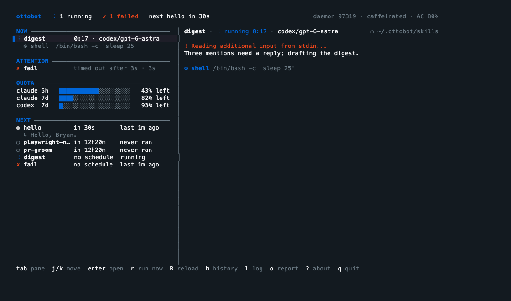
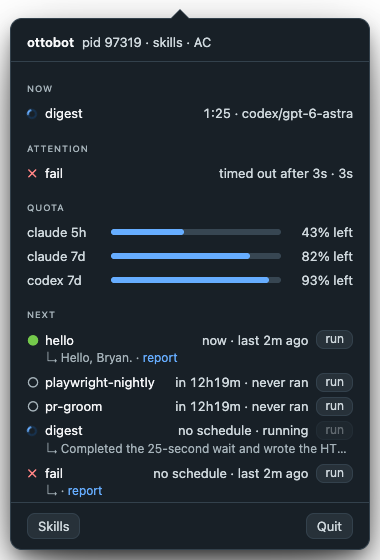

<p align="center"></p>

# ottobot

A higher-order coding agent. Point `otto` at a folder of skill markdown files,
each with a `trigger:` frontmatter. It evaluates triggers on a tick, fires an
agent run (`claude -p` or `codex exec`) when one is due, and shows
everything in a terminal UI: what's running, recent failures, runner quota,
upcoming fires, run history, and live session output.



<p></p>

## Install

```sh
curl -fsSL https://raw.githubusercontent.com/bryan-uipath/ottobot/main/install.sh | sh
otto                          # watches ~/.ottobot/skills
```

Installs `otto` to `~/.local/bin` (macOS arm64/x86_64, Linux x86_64 static);
the one-liner needs the repo to be public.
`| sh -s -- --tray` also installs the menu-bar app to `~/Applications`;
`--uninstall` removes both (keeps `~/.ottobot`). Pin with `OTTO_VERSION=v0.2.0`,
relocate with `OTTO_INSTALL_DIR`, preview with `OTTO_DRY_RUN=1`.

From source: `cargo install --path .` (to `~/.cargo/bin`).

Requires `claude` and/or `codex` on `PATH`. macOS runs are kept awake via `caffeinate`.
`otto daemon --install` keeps the scheduler running without the TUI.

The tray app is ad-hoc signed, not notarized. `install.sh` strips the quarantine
flag; if you downloaded the zip yourself, allow it on first launch via System
Settings → Privacy & Security → Open Anyway, or run
`xattr -dr com.apple.quarantine "ottobot tray.app"`.

## A skill

`~/.ottobot/skills/playwright-ci-triage.md`:

```markdown
---
name: playwright-ci-triage
description: Triage a failed scheduled Playwright CI run
model: opus
trigger:
  event: "Scheduled run of https://github.com/UiPath/flow-workbench/actions/workflows/playwright-ci.yml failed"
  check_every: 5m
  cooldown: 8h
timeout: 45m
---

A scheduled Playwright CI run failed. Find the failing tests, decide flake vs
regression, and write a short triage summary.
```

| key | meaning | default |
|---|---|---|
| `name` | skill id, used in run ids and state | file stem |
| `runner` | `claude` or `codex` | `--runner` or config |
| `model` | `opus`, `codex/gpt-6-astra`, a config alias, or a list — see Routing | runner default |
| `checker_model` | model for event/watch checks; runs on the skill's `runner` (not quota-routed) | sonnet (claude); runner default otherwise |
| `permission_mode` | claude `--permission-mode`; for codex, `bypassPermissions` → no sandbox, anything else → `-s <mode>` | `bypassPermissions` |
| `trigger.cron` | 5- or 6-field cron | |
| `trigger.event` | prose condition, compiled to a checker script (see below) | |
| `trigger.watch` | prose condition judged by the checker agent every `check_every`, with memory (see Superfans) | |
| `trigger.check_every` | event/watch poll interval | 5m event, 3h watch |
| `trigger.cooldown` | min gap before the same condition re-fires (ignored by watch) | 8h event, 0 cron |
| `timeout` | kill the run after this | 1h |
| `ledger_ttl` | prune `$OTTO_LEDGER` items older than this; `0`/`off` never (see Superfans) | 30d |

Exactly one of `cron` / `event` / `watch`.

## Superfans

A superfan is a skill whose job is to stare at one component and notice what
alerts miss. Pattern: a cheap watcher (`checker_model`, sonnet by default) runs
every few hours with a persistent notebook, and only when it sees something new
does the heavy body run (routed by quota) to investigate and write a report.

```yaml
model: [codex/gpt-6-astra@medium, claude/opus@medium]   # investigation
checker_model: sonnet                                    # watcher
trigger:
  watch: "Anything anomalous in prod/staging App Insights for Studio Web Flow?"
  check_every: 3h
```

`watch` is like `event` but never compiled to a script: the watcher agent reads
`$OTTO_MEMORY/notes.md` (baselines, known issues, open investigations), compares
now against it, rewrites it, and answers `{"fired", "key", "summary"}`. The body
gets the same `$OTTO_MEMORY` (`<store>/memory/<skill>/`), so investigations
build on each other. Watch fires ignore `cooldown` (the notebook dedupes; a
different incident must not wait) but stay rate-bounded: at most one run per
`check_every`, since a fire only comes from a check and checks pause while a
run is active. `$OTTO_LAST_FIRED_KEY` tells the watcher which incident ottobot
actually ran, so a deferred one fires again. The watcher runs on the skill's
`runner` with `checker_model` (sonnet on claude) and gets 30m per check.
`otto --check <skill>` works on a throwaway copy of the notes. The body
declares severity in `$OTTO_VERDICT` (see Reports); give each skill its own
"normal" counterexamples so routine noise stays `normal`. Programmatic
kick: `otto --run <skill>` or `{"type":"RunNow","skill":"…"}` on the socket.

`$OTTO_LEDGER` (`$OTTO_MEMORY/ledger.json`) is "already handled" state, set
for the body, checker scripts, and the watcher. The body adds each item it
handles (written atomically); the trigger skips ids already in it:

```json
{"items": {"<id>": {"at": "<RFC3339>", "pr": "repo#12"}}, "anything": "else"}
```

The daemon prunes `items` whose `at` is older than `ledger_ttl` (30d) after
each run and once a day; other keys and fields are kept, items without a
parseable `at` stay, and a file that doesn't parse is left alone (logged).

```
otto ledger <skill>              list items (id, at, a few fields)
otto ledger <skill> --rm <id>    forget one, so the trigger sees it again
otto ledger <skill> --clear      forget all
```

`Previous runs` in the body prompt lists the skill's last 5 finished runs (time, status, level, incident key, headline, report), so a known, unchanged issue stays `normal`.
`$OTTO_HISTORY` (`$OTTO_MEMORY/history.json`) is the same as JSON, rewritten before each run and check; set for the body, checker scripts, and the watcher.

Trust: a watcher reads logs, Slack and telemetry, any of which can carry
injected text, and what it writes to `notes.md` steers later runs. Both prompts
mark fetched content and the notebook as data, not instructions; keep superfan
bodies to drafts and reports (no sending, no pushing), and glance at
`<store>/memory/<skill>/notes.md` now and then.

## Routing

`model` names a model on the skill's runner, a `runner/model` pair, or a list of
either. With a list, the run goes to the candidate whose runner has the most
quota left (tightest window; unknown usage ranks below any known runner); ties keep list order.
The pick is logged (`routed to codex/gpt-6-astra (97% left vs claude 55%)`).

```yaml
model: [codex/gpt-6-astra@medium, claude/opus@medium]   # whichever has more headroom
model: tier1                                             # alias from config.json
```

`@minimal|low|medium|high|xhigh|max` sets reasoning effort (`claude --effort`,
codex `model_reasoning_effort`); any other `@…` stays part of the model id.

Routing compares **runners**, not models: candidates on the same runner share
one quota, so list one model per runner. Unknown usage ranks below any known
runner; a runner that failed preflight is a last resort.

`~/.ottobot/config.json` can define aliases (nested up to 3 levels):

```json
{ "models": { "tier1": ["codex/gpt-6-astra@medium", "claude/opus@medium"], "tier3": ["claude/haiku"] } }
```

## Power

The daemon polls `pmset -g batt` every 30s. On battery the TUI strip and tray
header turn orange and the tray icon gets a badge: caffeinate only blocks idle
sleep, so a closed lid still interrupts runs. `otto status` includes the power
state.

## Reports

Every run ends with a report. `$OTTO_REPORT` = `<store>/reports/<run-id>.html`;
the agent writes HTML there, or markdown to `$OTTO_REPORT_MD` (same name, `.md`).
If it wrote neither, ottobot writes a stub `.md` from the run's status and final
message. Markdown is rendered to a styled `.html` (links clickable, bare URLs
linked) and every report carries a meta line: skill, run id, status, agent
(`runner/model@effort`), duration, tokens, cost. Failed runs add Run details:
command (prompt redacted), exit code/signal, stderr tail, last 5 events. The TUI shows `⎙ report` (`o` opens it; history rows carry `⎙`), the
tray has a `Reports ▸` menu (latest per skill, plus the folder) and a `report`
link under each skill, and:

```
otto reports              latest report per skill
otto reports --all        every report
otto reports <skill> --open
```

Every run also gets `$OTTO_VERDICT` = `<store>/reports/<run-id>.verdict.json`,
a severity call read once when the run finishes:

```json
{"level": "critical", "incident_key": "flow-5xx-eu", "headline": "≤80 chars",
 "summary": "1–4 sentences", "evidence": ["5xx 2.1% vs 0.1% baseline"], "action": "next step"}
```

| level | meaning |
|---|---|
| `normal` | nothing needs a human soon |
| `critical` | a human should act soon |
| `immediate` | harm is ongoing and waiting materially worsens it: concrete impact, fresh numbers vs baseline, why it can't wait. Novelty, staging-only, or one region alone is not immediate |

Missing or invalid file (unknown level, bad JSON) = unassessed, never treated
as normal. The headline is cut to 80 chars; `immediate` with no `evidence`
becomes `critical`. The report gets a TL;DR box at the top (yellow critical,
red immediate; normal is one dim line); all verdict text is HTML-escaped.

Alerts: one per (skill, `incident_key`), in `<store>/alerts.json` (outlives the
200-run window). A critical/immediate verdict opens or updates it (a later run
can lower it); `normal` on the same key clears it, on another key it doesn't.
Failed and unassessed runs never touch alerts. Dismiss (tray, or `Dismiss` on
the socket) hides it until a strictly higher level arrives; opening the report
doesn't dismiss.

Notifications: an alert entering `immediate` (new, escalated, or re-opened)
gets a macOS notification, at most one per skill per 6h (agents mint new keys
for one problem); capped ones still show in the tray. The daemon decides and
sets `notify` on the alert; the tray claims it with `Notified` and posts it
(`otto · <skill> · <headline>`, first sentence of the summary; click opens the
report). Decision, cap time, and claim live in `alerts.json`, so restarts don't
re-notify. Needs the tray running as the installed `.app` (a dev binary posts
as Terminal) and notification permission for it (macOS asks on the first one).

## Event triggers

On first check, `checker_model` writes a script for the condition to
`~/.ottobot/projects/<root>/checkers/<skill>-<trigger-hash>-v<N>` (`N` bumps when ottobot changes what scripts get, forcing a recompile) and verifies it
once. Every `check_every` the script runs (cwd = skills root, `$OTTO_SKILL`,
`$OTTO_MEMORY`, `$OTTO_LEDGER`, `$OTTO_HISTORY` set) and prints one JSON object:

```json
{"fired": true, "key": "run-1234", "summary": "playwright-ci #1234 failed: 3 tests"}
```

`key` is the dedupe key (same key never fires twice); `summary` is passed to
the run as trigger context. If the script errors, the checker model answers
directly with tools; three consecutive script failures delete the script so
the next check recompiles. Editing the trigger changes the hash, so it also
recompiles. Hand-edit the script if the model got it wrong.

```
otto --check <skill>        compile if needed, run the checker once, print the verdict
```

## Dedupe

A due trigger is skipped when the skill already has an active run, the same
trigger key already fired, or the cooldown hasn't elapsed. The skip reason is
shown inline on the skill. `r` (run now) bypasses all three.

Two hashes per skill: the whole file, and the trigger block alone. Editing the
prompt body never resets dedupe state; editing the trigger does.

## CLI

```
otto [ROOT]                 TUI. ROOT defaults to config skills_root, then ~/.ottobot/skills
otto daemon [ROOT]          scheduler + socket server, foreground (see Daemon)
otto daemon --install       LaunchAgent: start at login, keep alive (--uninstall removes it)
otto status [--json]        one-line daemon summary; exit 1 if no daemon
otto --list                 discovered skills, hashes, parsed triggers
otto --run <skill>          one headless run, events to stdout (bypasses dedupe)
otto --show <run-id>        dump a stored run's metadata and events
otto --check <skill>        evaluate an event trigger once (compiles the checker if needed)
otto --usage                each runner's version and quota (claude 5h/7d, codex 7d)
otto --version              version and build commit, e.g. otto 0.2.0 (bf35001-dirty)
otto --tick 30s --runner claude
```

Keys: `tab` cycle NOW / ATTENTION / NEXT / session · `j/k` move · `enter` open
session (on a NEXT skill: its history) · `esc` clear filter · `r` run now ·
`R` reload · `h` history · `l` scheduler log · `g/G` top / follow · `?` about ·
`q` quit.

## Daemon

`otto daemon` runs the scheduler, store, caffeinate, and usage refresh, and
serves `~/.ottobot/otto.sock` (mode 0600). One daemon per machine, one skills
root. On start it removes a stale socket, refuses (exit 1) if another daemon
answers, and writes `~/.ottobot/daemon.json` (`pid`, `root`, `socket`,
`started_at`, `commit`); SIGINT/SIGTERM remove both.

`--install` writes `~/Library/LaunchAgents/com.ottobot.daemon.plist`
(`otto daemon <root>`, RunAtLoad, KeepAlive, your current `PATH` so
`claude`/`codex` resolve, stdout/stderr to `daemon.{out,err}.log` in the store
dir) and `launchctl bootstrap`s it. `--uninstall` boots it out and deletes the
plist. macOS only.

`otto` connects to the socket first: same root → TUI drives the daemon
(status strip shows its pid, or "daemon disconnected · retrying" every 2s); different root
→ prints both and exits 1; no daemon → in-process scheduler as before (exits
with the TUI). `--run` goes through the daemon when one is up; `--check` is
always in-process. Locks are `flock`s the kernel drops on exit:
`~/.ottobot/daemon.lock` (one daemon per machine) and `<store>/scheduler.pid`
(one scheduler per root, daemon or in-process). `--install` forwards explicit
`--tick`/`--runner`.

The protocol is unversioned: after upgrading the binary, restart the daemon
(a client that can't parse its answers exits with that hint). `Status`/`Snapshot`
carry the daemon's build `commit`; `otto status` and the TUI strip show it.

Wire: newline-delimited JSON, one request → one response, connection reusable.

```
{"type":"Snapshot"}                         → {"type":"Snapshot","data":{root, skills, runs (meta only), log, …}}
{"type":"Events","run":"<id>","from":N}     → {"type":"Events","data":[…events N..]}
{"type":"RunNow","skill":"<name>"}          → {"type":"Ok"} | {"type":"Error","data":"no skill …"}
{"type":"Reload"}                           → {"type":"Ok"}
{"type":"Dismiss","skill":"<name>","key":"<incident_key>"} → {"type":"Ok"} | {"type":"Error","data":"no alert …"}
{"type":"Notified","skill":"<name>","key":"<incident_key>"} → {"type":"Ok"} | {"type":"Error","data":"no pending notification …"}
{"type":"Status"}                           → {"type":"Status","data":{root, pid, running, skills, last_failure, next_fire, runner_usage, power, commit}}
```

## Tray

`tray/` is a macOS menu-bar app (Tauri v2): tooltip with alert and running/failed
counts, a popover with ALERTS (when any) above the same NOW / ATTENTION / QUOTA /
NEXT board, and Run now / Reload from its menu. The icon gets a red dot for an
immediate alert, yellow for critical, else the battery badge. It is a socket client only, so it needs the
daemon. The popover header and tooltip show `tray <sha> · daemon <sha>`, with ⚠ when
they differ (restart the stale one). Build: `cd tray/src-tauri && cargo tauri build`. See `tray/README.md`.

## Runners and usage

`runner/` implements `Runner` per agent CLI: `command()`, `parse_line()` into
normalized `RunEvent`s, `preflight()`, and `usage()`. Usage reports each
rate-limit window as a percent used so the scheduler can route to whichever
runner has headroom (not wired yet; TUI QUOTA section refreshes it every 5m, `--usage` prints it).

| runner | invocation | usage source |
|---|---|---|
| `claude` | `claude -p --output-format stream-json` | `api.anthropic.com/api/oauth/usage` with the Claude Code OAuth token (keychain or `~/.claude/.credentials.json`) |
| `codex` | `codex exec --json -C <cwd>` | last `rate_limits` in the newest `~/.codex/sessions/**/*.jsonl` rollout |

## Config and state

`~/.ottobot/config.json` (all optional, CLI flags win):

```json
{ "skills_root": "~/code/my-skills", "runner": "claude", "tick": "1m" }
```

Per-project state lives in `~/.ottobot/projects/<root-path-with-dashes>/`,
same scheme as `~/.claude/projects`:

```
state.json            per-skill: hashes, last fired key/time, last run id, last check
alerts.json           open/dismissed alerts per (skill, incident key), last notification per skill
checkers/<skill>-<h>-v<N>  compiled event checker scripts
runs/<id>.json        run metadata (status, cost, tokens, cwd)
runs/<id>.jsonl       normalized event stream (text, tool calls, results, usage)
ottobot.log.<date>    scheduler log
```

Runs left `Running` by a crash are reported as failed on next start.

## `/otto` Claude Code skill

`claude-skill/otto/SKILL.md` teaches Claude Code to distill the current
conversation into an ottobot skill: after a one-off investigation, `/otto`
checks whether there is a clear trigger, a repeatable procedure, and a
definition of done, then writes the skill file into your skills root.

```sh
ln -s "$PWD/claude-skill/otto" ~/.claude/skills/otto
```

## Architecture

```
skill.rs      discover *.md with trigger frontmatter, hash file + trigger block
trigger.rs    cron via croner; event spec parsing
scheduler.rs  tick loop, dedupe gate, spawn + stream runs
checker.rs    event checks: compile prose → script, run it, agent fallback; `watch` = agent + $OTTO_MEMORY
route.rs      model candidates + config aliases → runner/model with the most quota left
runner/       Runner trait: command(), parse_line() -> RunEvent, preflight(), usage(); claude + codex
store.rs      ~/.ottobot/projects/<root>/ state, run metadata, event logs
state.rs      shared in-memory state between scheduler and clients
proto.rs      Snapshot/Status DTOs, socket Request/Response, request handler
daemon.rs     `otto daemon`: socket server, daemon.json, signals, launchd install
client.rs     Backend: in-process (Local) or socket (Remote, reconnecting)
tui/          ratatui over a Backend: status strip, board rail (now/attention/quota/next) or history, session/log, `?` about
otto.rs       Otto art (about overlay) from assets/otto.ans
tray/         macOS menu-bar client (Tauri v2, static HTML popover) over the daemon socket
```

## Roadmap

1. ✅ discovery, hashing, cron triggers, claude runner, TUI, caffeinate, config
2. ✅ event triggers: compile prose → checker script via sonnet, agent fallback, dedupe key from checker output
3. `env.repo`: fetch, worktree per run on `ottobot/<skill>/<run-id>`, worktree removed after, branch kept
4. ✅ codex runner, per-runner preflight + usage
4b. ✅ route by usage: `model: [a, b]` picks the runner with the most quota left
5. ✅ headless daemon + `otto status`
6. ✅ macOS menu-bar tray (daemon client)

## Otto art

`assets/otto.ans` is generated from the flat SVG:

```sh
RAMP=" █" cargo run -p otto-render -- assets/otto-blue.png 40 0 6 > assets/otto.ans
```

Args: source, columns, luminance weight, alpha-opening radius (strips the
propeller motion-blur arcs). A symmetric blade is drawn over the detected hub.
